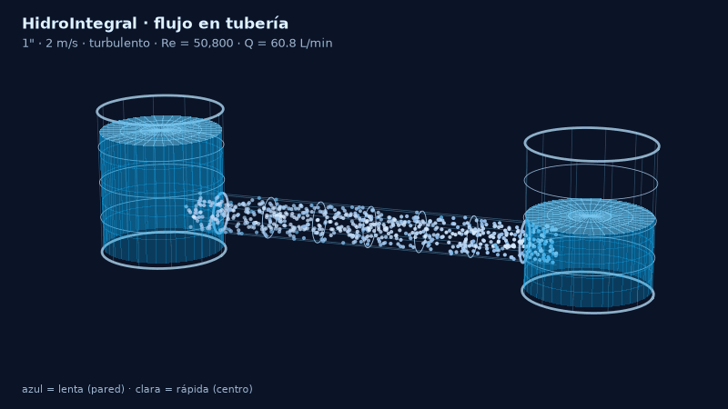
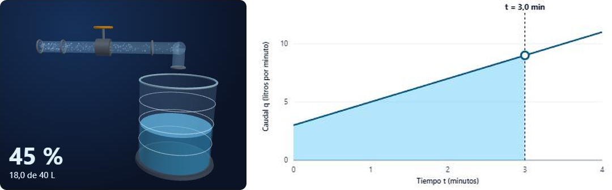
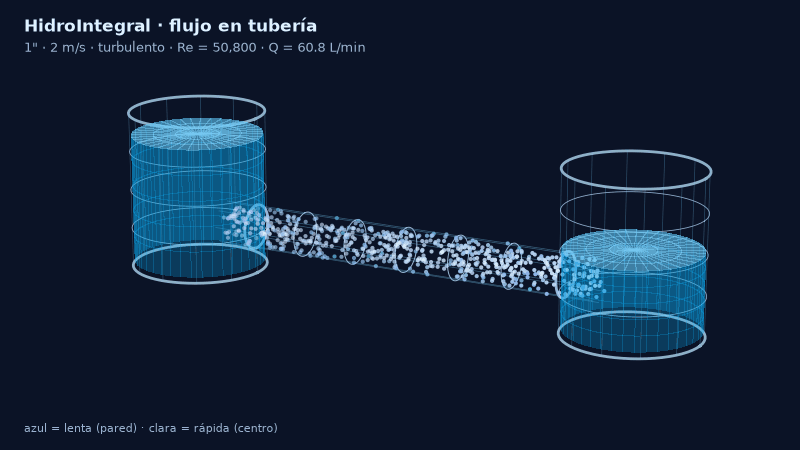

# HidroIntegral

**¿Cuánta agua hay en un tanque? ¿Cuánta pasa por una tubería?** HidroIntegral responde ambas preguntas con integrales definidas y las muestra como escenas en 3D: un tanque que se llena y una tubería por la que fluye el agua.



Proyecto final de Cálculo II (2026).

## ¿Qué es?

Cuando una llave se abre poco a poco, el caudal no es constante, y entonces la cuenta «litros = caudal × minutos» ya no sirve. La solución es la **integral**: sumar el agua que entra en cada instante. Geométricamente, es el **área bajo la curva del caudal**.

HidroIntegral hace visible esa idea: mueves el tiempo y ves a la vez cómo cambia la curva, el área sombreada y el nivel del tanque.

## Qué puedes hacer

### Volumen en un tanque



- Entender primero **qué es el caudal** (litros por minuto, y cómo se relaciona con `Q = V/t` y `Q = A·v`).
- Elegir entre **seis situaciones reales** (una llave que se abre, un caudal constante, un caudal que se acelera, una bomba con ciclos, la lluvia sobre un techo y un depósito que se vacía) y ver **por qué** el caudal tiene esa forma.
- Ajustar la llave con **deslizadores** (caudal inicial, aumento por minuto y duración) y ver la fórmula `q(t) = k·t + q₀` con cada parte rotulada y su integral resuelta.
- Escribir **tu propia función** del caudal, por ejemplo `12+8*sin(t)`.
- Reproducir la animación o **arrastrar sobre la gráfica** para viajar en el tiempo.
- Cambiar la capacidad del tanque y ver si **se desborda** y cuándo se llena.
- Comparar con el **caudal promedio** (un rectángulo con la misma área).
- Ver cómo lo calcula el computador: el valor exacto con el teorema fundamental del cálculo, y las aproximaciones con rectángulos de Riemann, trapecio y Simpson.

### Capacidad de una tubería



- Cambiar el **diámetro** de la tubería y la **velocidad** del agua.
- Ver el agua fluir en 3D: las partículas del centro avanzan más rápido que las de la pared.
- Consultar el caudal, el número de Reynolds y el régimen (laminar o turbulento).
- Comprobar que sumar los anillos del perfil de velocidades da el mismo caudal que la fórmula simple `Q = A·v`.

## Las ideas matemáticas

| Problema | Integral | Idea |
|---|---|---|
| Volumen acumulado | `V = ∫ₐᵇ q(t) dt` | El área bajo la curva del caudal. |
| Caudal de una tubería | `Q = ∫₀ᴿ v(r)·2πr dr` | Se suma el aporte de cada anillo del tubo. |
| Valor exacto | `∫ₐᵇ q(t) dt = F(b) − F(a)` | Teorema fundamental del cálculo. |

Con `q(t) = 2t + 3` L/min de 0 a 4 min, el volumen exacto es **28 L**. La suma de Riemann por la izquierda con 4 rectángulos da 24 L, y el trapecio y Simpson dan 28 L.

> Las animaciones son esquemáticas: las velocidades relativas siguen el perfil real de velocidades, pero el tamaño y la rapidez en pantalla están escalados.

## Tecnologías

- **Cálculo:** Python, FastAPI, SymPy (integral exacta) y NumPy (métodos numéricos). Python también calcula las partículas de las animaciones.
- **Interfaz:** React, Vite, Three.js (escenas 3D) y gráficas propias en SVG.
- **Empaquetado:** Docker.

La función del caudal que escribe el usuario se valida antes de evaluarse: nunca se ejecuta código arbitrario.

## Ejecutarlo en tu computador

Necesitas [Python 3.12](https://www.python.org/downloads/) y [Node.js](https://nodejs.org/). Abre dos terminales.

**Terminal 1: el servidor de cálculo**

```bash
cd backend
pip install -r requirements.txt
uvicorn hidro.api:app --reload
```

**Terminal 2: la página**

```bash
cd frontend
npm install
npm run dev
```

Abre http://localhost:5173 en el navegador. La documentación interactiva de la API está en http://127.0.0.1:8000/docs.

### Con Docker

```bash
docker build -t hidrointegral .
docker run -p 8080:7860 hidrointegral
```

Abre http://localhost:8080.

## Pruebas

```bash
cd backend
pytest -q
```

Las pruebas reproducen casos calculados a mano (por ejemplo, los 28 L de arriba y una tubería de 1" a 2 m/s que da 60.8 L/min).

## Estructura del proyecto

```
backend/
  hidro/
    volumen.py       integrales de q(t): exacta, Riemann, trapecio, Simpson
    tuberia.py       capacidad, número de Reynolds y perfil de velocidades
    animacion.py     partículas de las animaciones 3D
    render_gif.py    genera un GIF de la tubería solo con Python
    api.py           API (FastAPI)
    servidor.py      servidor único: página + API
  tests/             pruebas (pytest)
frontend/
  src/pages/         las dos páginas principales y las páginas legales
  src/components/    tanque 3D, tubería 3D, gráficas y lecturas
docs/                capturas y notas del proyecto
Dockerfile           construye la página y el servidor en una sola imagen
```

## Generar el GIF de la tubería

```bash
cd backend
python -m hidro.render_gif --diametro 1 --velocidad 2 --salida animacion_tuberia.gif
```

## Licencia

MIT. Consulta el archivo [LICENSE](LICENSE).
